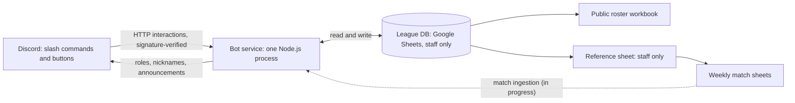

# GGB Bot

Roster, transfer, and match management for an online competitive card game league, run through Discord and backed by a Google Sheets database that non-technical staff can read and edit. Built and operated as a volunteer project for 32 teams, 380 active players, and 10 staff.

Status: Live: roster transfers with staff approval, nightly nickname and membership sync. In progress: match result ingestion.

Terms: The code uses the league’s own words. A “gym” is a team and a “trainer” is a player.

## Features

| Command | Who | What it does |
|---|---|---|
| `/roster add`, `remove`, `update-trainer` | Gym Leaders and Vice-Leaders | Request a roster change for their gym. Leadership changes and removing the Vice-Leader are the Leader's alone |
| `/roster cancel-request` | Gym Leaders and Vice-Leaders | Withdraw a pending request |
| `/gym rebrand`, `disband` | Gym Leaders | Request a new name, abbreviation and emote, or to disband (off-season only) |
| `/gym cancel-request` | Gym Leaders | Withdraw a pending gym request |
| `/ping` | Anyone | Check the bot is responding |

Each request posts an approval card in the staff channel. When staff approve it, the bot updates the League DB, changes the members' Discord roles and announces the change.

## Status

- **Live in production:** roster transfers with staff approval (`/roster`, `/gym`), and the nightly nickname and membership sync.
- **In progress:** match result ingestion (`src/match/` has the sheet layout, parser and test fixtures so far).
- **Not started:** League Stats views (`src/views.ts` is a placeholder).

## How it works



## Design decisions

**Google Sheets is the database.** League staff are non-technical and need to read and correct league data themselves, so the data lives in a spreadsheet they already know. A relational database with a synced sheet was designed and dropped, because a two-way sync cost more than it was worth. The tables are normalized, so a later move to a relational database is an import, not a redesign. Google Sheets has no constraints and no transactions, so the bot enforces every league rule in code. `src/schema.ts` defines every tab and column.

**Match sheets never touch the database directly.** Players edit match sheets live through a shared link. A staff-only reference sheet sits between the database and the match sheets, so a match sheet can pull roster, team and deck data without exposing the full database or being able to write back to it.

**HTTP interactions, not a gateway bot.** Discord POSTs each slash command and button press to `POST /interactions`. The bot acknowledges at once and fills in the reply when the sheet and Discord work is done. It always shows as offline in Discord; that is expected.

**Exactly one process.** Work is serialized with in-memory locks, so only one instance may ever run. An approval touches several systems (the database, Discord roles, an announcement), and Sheets has no transactions to roll back a partial one. If the bot stops partway through an approval, startup recovery finishes it on the next start. The cost is a few seconds of downtime on each deploy.

**Graceful deploys.** On SIGTERM the bot stops taking new interactions and waits up to 25 seconds for the ones in progress. `GET /health` returns 503 while starting up or shutting down, so the host only sends traffic to a ready process.

**Retries are chosen by failure type.** Sheets calls retry with backoff, up to 5 times. Rate-limited calls always retry, since they were refused. Server errors and network failures retry too. Appends are never retried after a timeout, because an append that timed out may have landed and a retry could write the row twice.

**The nightly sync retries, then escalates.** The nightly job that refreshes trainer nicknames and removes players who left the server runs at 9 PM Denver. It makes up to 3 attempts, 10 minutes apart, and alerts staff only after the last one fails. An error a retry cannot fix, such as a sheet header someone changed by hand, alerts staff at once. A catch-up run at startup covers a missed night. Sheet layout problems alert staff at most every 10 minutes, however many commands hit them.
## Project layout

```
src/
  server.ts          Express server: /interactions (signature-checked) and /health
  interactions.ts    Deferred replies and button handling
  commands/          Slash command definitions and handlers (index.ts lists them)
  roster/            Roster requests: checks, approval cards, approval, Discord roles, recovery
  match/             Match sheet parsing (in progress)
  schema.ts          League DB tabs and columns
  sheet-rows.ts      Typed reads and writes of League DB rows
  google.ts          Sheets client with timeouts and retries
  discord.ts         Discord REST calls
  locks.ts           In-memory locks
  seasons.ts         Active season, in-season vs off-season
config/league.json   Role names and relegated gyms (reviewed in git)
scripts/             Dev and admin tools run with tsx (not part of the build)
test/                Tests and their fixtures
render.yaml          Render deploy config
```

## Running locally

Requires Node 22 or later, a Discord application and test server, and a Google Cloud service account with a JSON key.

1. **Install and configure**

    ```sh
    npm install
    cp .env.example .env
    ```

    Fill in `.env`. To get Discord IDs, turn on Developer Mode (User Settings > Advanced) and right-click the server, channel or role > Copy ID.

    | Variable | Value |
    |---|---|
    | `DISCORD_APPLICATION_ID`, `DISCORD_PUBLIC_KEY` | Developer Portal > your app > General Information |
    | `DISCORD_BOT_TOKEN` | Developer Portal > Bot > Reset Token |
    | `DISCORD_GUILD_ID` | The server the bot runs in |
    | `DISCORD_STAFF_CHANNEL_ID` | Where approval cards and staff notices go |
    | `DISCORD_TRANSFER_ANNOUNCEMENTS_CHANNEL_ID` | Where approved roster changes are announced |
    | `DISCORD_MATCH_RESULTS_ANNOUNCEMENTS_CHANNEL_ID` | Where match results will be announced (not used yet) |
    | `DISCORD_STAFF_ROLE_IDS` | Comma-separated IDs of the roles allowed to approve and reject requests |
    | `GOOGLE_SERVICE_ACCOUNT_KEY_B64` | The service account key, base64-encoded: `base64 -i key.json` |
    | `GOOGLE_LEAGUE_DB_ID` | The workbook ID, from its URL: `docs.google.com/spreadsheets/d/<ID>/edit` |

2. **Set up a League DB workbook.** Create an empty Google Sheet and share it as Editor with the service account (the `client_email` in its key). Then build the tabs and check access:

    ```sh
    npm run db:setup
    npm run sheets-smoke
    ```

3. **Register the slash commands** with your server:

    ```sh
    npm run register
    ```

4. **Start the bot and expose it to Discord:**

    ```sh
    npm run dev
    cloudflared tunnel --url http://localhost:3000
    ```

    Set the dev app's Interactions Endpoint URL (Developer Portal > General Information) to the tunnel URL plus `/interactions`. The tunnel URL changes each time cloudflared restarts.

5. **Discord server settings.** The bot needs Manage Roles, and its role must sit above every gym, gym fan, trainer and leadership role. To limit `/roster` and `/gym` to the request and staff channels, use Server Settings > Integrations > the bot.

## Commands

| Command | What it does |
|---|---|
| `npm run dev` | Runs the server, reloading on save |
| `npm run build` / `npm start` | Compiles to `dist/` and runs the compiled server |
| `npm test` | Runs the tests |
| `npm run typecheck` | Type-checks `src/`, `scripts/` and `test/` |
| `npm run register` | Replaces the server's slash commands with those in `src/commands/` |
| `npm run db:setup` | Creates any missing League DB tabs. Safe to re-run: it never overwrites a tab whose header doesn't match the schema |
| `npm run sheets-smoke` | Checks the service account can read and write the workbook |
| `npm run import -- --season N --dry-run` | Previews importing gyms and trainers from Discord roles. Writes nothing |
| `npm run import -- --season N --commit [--force]` | Runs the import. `--force` clears and re-imports the Gyms, Trainers and Roster history tabs |
| `npm run sync-names` | Previews the nightly name refresh: what the bot would change in Trainers, and whether its 90% safety check would trip. Writes nothing; the bot does the writing itself at 9 PM Denver |
| `npm run capture-match-fixtures` | Re-captures the match test fixtures, with players replaced by fake ones |

The scripts read `.env` by default. Add `--env <file>` to use another, e.g. `npm run register -- --env .env.production`. With any file other than `.env`, a script shows which server and workbook it will touch and waits for you to type `yes`.

**Changing the schema:** when you add or change a column in `src/schema.ts`, `db:setup` refuses on that tab. In a dev workbook, delete the tab and re-run `db:setup`. In the real League DB, insert the column by hand where the schema expects it, then run `db:setup` to confirm.

## Deploying

Production runs on [Render](https://render.com) as a single always-on web service defined in `render.yaml`. The comments in that file explain each setting.

- Deploys come from the `production` branch: `git push origin main:production`.
- Set the environment variables in the Render dashboard. `render.yaml` lists their names but never their values.
- After the first deploy, set the production app's Interactions Endpoint URL to `https://<service>.onrender.com/interactions`.
- When command definitions change, wait for the deploy to go live, then run `npm run register -- --env .env.production`.
